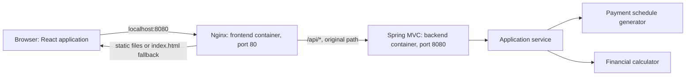

# Architecture

## System boundaries

The monorepo contains independently built applications: a Java 17 / Spring Boot 4.0.9 HTTP API built with Maven Wrapper, and a React 19 / TypeScript single-page application built with Vite. The backend owns scheduling and financial calculations. The frontend validates input, requests simulations, and presents returned values in Brazilian Portuguese with BRL formatting.

There is no database, authentication, saved simulation history, or external calendar service. Each request builds a schedule and result in memory.

## Backend layers

Paths below are relative to `backend/src/main/java/com/loancalculator/`.

| Package | Responsibility |
| --- | --- |
| `controller/` | Bind the JSON request, trigger Bean Validation, and delegate to the service. |
| `dto/` | Define request constraints and the public schedule, entry, summary, and event-type records. |
| `service/` | Convert percentage points into a fractional rate, invoke scheduling and calculation, check final settlement, and map domain values into rounded response DTOs. |
| `domain/` | Generate chronological events and calculate balances without Spring or HTTP dependencies. Scheduling and arithmetic are separate operations. |
| `exception/` | Translate validation, unreadable requests, calculation failures, and unexpected failures into HTTP Problem Details. |
| `config/` | Register the domain objects as Spring beans and configure the existing endpoint's CORS allowlist. |

The domain uses mutable value holders, but calculation state and generated collections are created per invocation. The application has no repository layer or persistence dependency.

## Request and response flow

1. `LoanForm` validates strings and constructs ISO dates and JSON numbers.
2. `loanApi.ts` calls `api/httpClient.ts`, which sends a JSON `POST` with `Content-Type` and `Accept` headers.
3. Spring MVC binds `AmortizationScheduleRequest`; invalid input stops before service invocation.
4. `LoanService` constructs the domain loan, generates events, and calculates their financial values.
5. The service checks for a nonempty result, at least one installment, and exact zero final outstanding balance. It rounds response amounts and aggregates the summary from unrounded values.
6. The frontend checks the response's top-level shape and displays backend-supplied rows and totals without financial recomputation.

The sole application endpoint is `POST /api/v1/loans/amortization-schedule`. A successful response has `schedule` and `summary`; errors use `application/problem+json`. See [business rules](business-rules.md) for field meanings and failure behavior.

## Frontend boundaries

Within `frontend/src/`, `features/loan-calculator/` contains form validation, API types, feature-specific transport/error mapping, result components, and the request-state coordinator. `components/` contains reusable controls; `utils/format.ts` handles representation conversion; `config/env.ts` selects an optional API prefix.

`LoanCalculator.tsx` manages idle, stale, loading, success, and error states using React hooks. Editing inputs hides previous results and aborts an active request. Clearing returns to idle; retry resends the failed request. Abort checks prevent cancelled responses from restoring stale results. No router or global state library is installed.

TypeScript types describe the response, but runtime validation only checks that `schedule` is an array and `summary` is a non-null object; individual fields are not schema-validated.

## Docker execution

[compose.yaml](../compose.yaml) defines exactly two services on the default Compose network:

- `backend`: Maven Wrapper runs `verify` in a JDK 17 build stage. A JRE 17 runtime runs the executable JAR as user 10001, with curl retained for readiness checks. Port 8080 is internal and has no host mapping.
- `frontend`: Node.js 24 runs `npm ci` and `npm run build`. The runtime contains Nginx and static assets, with host port 8080 mapped to container port 80. It starts after the backend's `OPTIONS` readiness probe succeeds on the existing endpoint.

[nginx.conf](../frontend/nginx.conf) proxies `/api/` to `http://backend:8080`, retaining the request URI and forwarding Host, client IP, forwarded chain, and scheme. Docker DNS is re-resolved periodically. Other paths use `try_files` with an `index.html` fallback; this supports SPA entry paths even though the current app has no client-side router.

The browser uses one public origin and never resolves `backend`. No added CORS configuration is needed for this path. The health probe checks HTTP availability, not calculation correctness or ongoing frontend availability.

## Local execution

Maven Wrapper starts Spring Boot directly at `http://localhost:8080`; npm starts Vite at `http://localhost:5173`. [vite.config.ts](../frontend/vite.config.ts) fixes the development port and proxies `/api` to the local backend without rewriting paths. Docker and Nginx are unnecessary in this mode.

The default API prefix is empty in both modes. `VITE_API_BASE_URL` is an optional build-time override, not a required environment setting. The backend additionally allows direct cross-origin calls from localhost ports 5173 and 4173 through `loan.api.allowed-origins`. Vite preview serves the production assets but has no configured API proxy; use Nginx or an explicit API-origin override for a connected preview.
